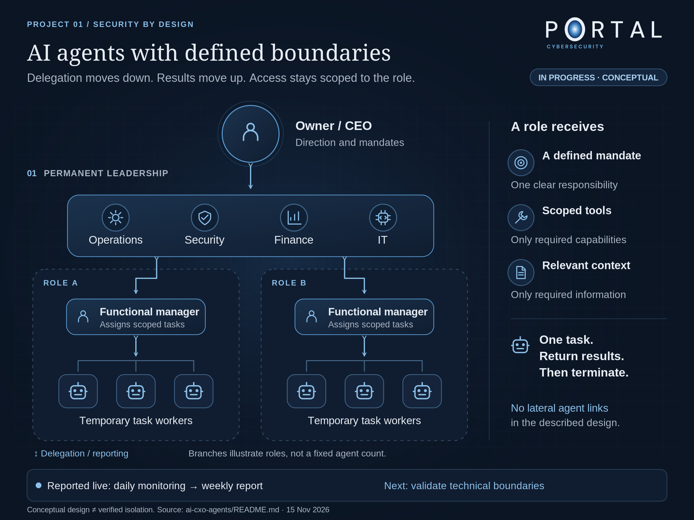

# 🤖 AI CXO Agents (OpenClaw)

> **Status:** In progress — built and documented incrementally

## The idea

Most people run an AI assistant as a single chat window. This project asks a different question: **what happens if you organise AI agents the way you organise a company?**

Instead of one general-purpose assistant, the platform runs a structured organisation of agents — a small permanent leadership layer, functional managers under them, and short-lived workers that are spawned to do one narrow, mechanical task and then disappear. Each agent has a defined role, a defined mandate, and nothing beyond it.
        You (owner / CEO)
               |
      Permanent leadership layer
     (operations, security, finance, IT)
               |
       Functional managers
               |
    Ephemeral task-level workers

Everything runs self-hosted on my own hardened server. Nothing about the setup depends on a third party hosting the agents.

## Why this is a security project

An autonomous agent is, for all practical purposes, a user account that can be socially engineered. It reads untrusted input, it holds credentials, and it takes actions. That makes the interesting problem an **information security problem**, not an AI problem — and the design applies the same principles you'd apply to human staff and service accounts:

| Principle | How it's applied |
| :--- | :--- |
| **Need-to-know** | Each agent is told only what its own function requires. Infrastructure, topology and unrelated services are deliberately withheld — even from agents running on that infrastructure. |
| **Least privilege** | Tooling and capabilities are scoped per role, not shared globally. |
| **Strict reporting lines** | No lateral agent-to-agent communication. All coordination flows vertically, so no agent can be used as a pivot to reach another. |
| **Blast radius** | Isolation and containment assumed by default; the platform is designed on the premise that an agent *will* eventually be manipulated. |
| **Data hygiene** | Sensitive data is masked before anything is written to long-term storage. |
| **Attack surface reduction** | Components that don't need to listen on a network don't. Internal services were rewritten to remove open ports entirely. |

The goal is not just "agents that work" — it's agents that fail safely.

## ✅ What's done

- Hardened host and an isolated container runtime for the platform
- Agent hierarchy, role separation and mandates defined and documented
- **First live pipeline:** automated, scheduled external monitoring that collects and triages information daily and escalates into a weekly report — running unattended on a schedule
- Architecture for long-term agent memory: what an agent is allowed to remember, where it's stored, and how it's kept separated per role
- Sanitisation layer designed to strip sensitive data before storage
- Specification for the first task-level worker agent, deliberately chosen to have zero blast radius and deterministic, testable output

## 🔜 Roadmap

- Additional functional pipelines (IT operations, cost tracking, tech watch)
- Hardening review and threat modelling of the agent-to-agent boundaries
- Validation of the target agent count against real hardware and cost limits

## 💡 What I've taken away so far

- The hardest part isn't getting agents to do things — it's deciding what they're allowed to know. Most failure modes trace back to an agent having  context it never needed.
- Prompt injection stops being theoretical the moment an agent reads external content on a schedule.
- Classic infosec doctrine (segmentation, least privilege, need-to-know) maps onto autonomous agents almost unchanged.

---

## Framework references

The following references provide design and threat context. The public description does not establish how all agent boundaries are technically enforced.

| Framework | Reference | Connection to this project |
| :--- | :--- | :--- |
| D3FEND | [D3-ACH · Application Configuration Hardening](https://d3fend.mitre.org/technique/d3f:ApplicationConfigurationHardening/) | Relevant to the described reduction of listening services and restriction of runtime capabilities. Configuration-level evidence would be needed for a verified mapping. |
| ATT&CK | [T1005 · Data from Local System](https://attack.mitre.org/techniques/T1005/) | Relevant if a manipulated agent uses its file access to collect information outside its task. This is a threat scenario, not a reported incident. |
| ATT&CK | [T1611 · Escape to Host](https://attack.mitre.org/techniques/T1611/) | Relevant to the isolated container runtime and its boundary with the host. It does not describe prompt injection itself. |

Role instructions and reporting lines alone do not prove access isolation. A more detailed mapping would need the enforced permissions, data boundaries and boundary-test results. AI-specific manipulation should be assessed separately rather than assigned an approximate ATT&CK identifier.

### Related standards and frameworks

These are thematic connections to the documented work, or prospective references where the project is incomplete. They do not imply that the original project was designed against these editions.

| Reference | Relevant area | Project connection and evidence boundary |
| :--- | :--- | :--- |
| [ISO/IEC 27002:2022](https://www.iso.org/standard/75652.html) | Access control and protection of information. | Role-specific tools, limited information access and intended separation provide design-level connections. Instructions alone do not demonstrate technical enforcement. |
| [CIS Controls v8.1](https://www.cisecurity.org/controls/cis-controls-list) | Control 6: Access Control Management; Control 3: Data Protection. | Applicable to enforced agent permissions and handling of stored information. The public description does not establish all access checks or that the designed sanitisation layer is operational. |
| [NIST CSF 2.0](https://csrc.nist.gov/pubs/cswp/29/the-nist-cybersecurity-framework-csf-20/final) | Govern and Protect. | Defined mandates relate to responsibilities; enforced permissions and data boundaries relate to protection. A detailed mapping needs configuration evidence and boundary tests. |

ISO references are thematic; no clause-by-clause assessment has been performed. CIS references identify top-level Controls, not all underlying safeguards. Framework alignment is not certification or proof of compliance.

*Reference review: 14 November 2026. MITRE mappings and the additional framework connections are project-level interpretations, not independently verified security coverage.*
