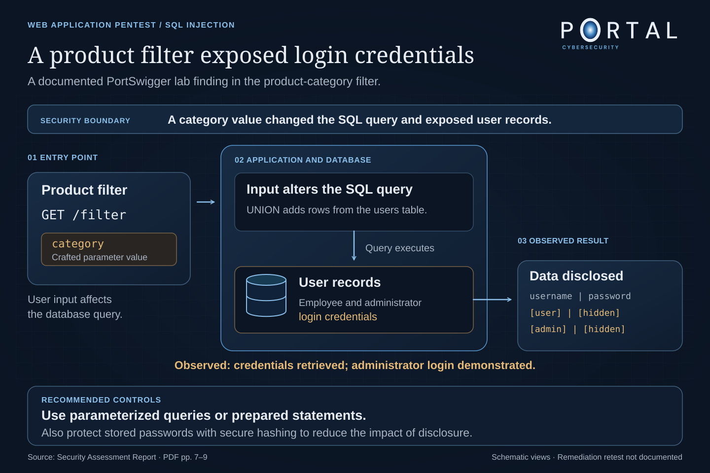
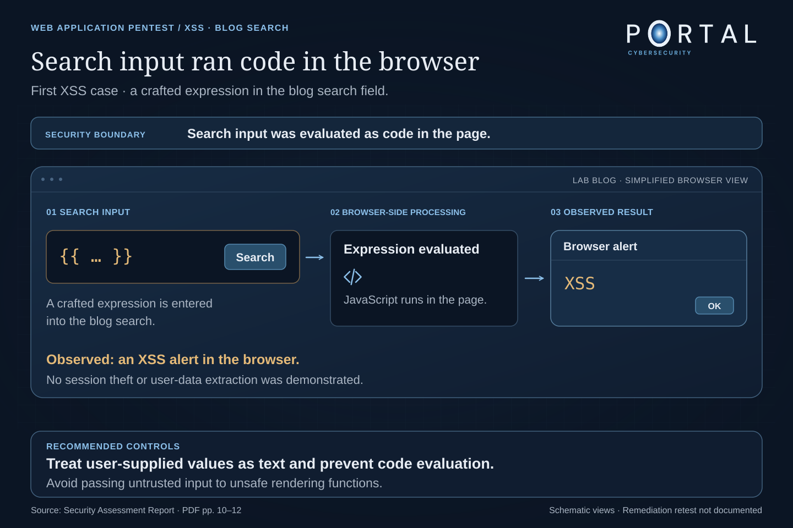
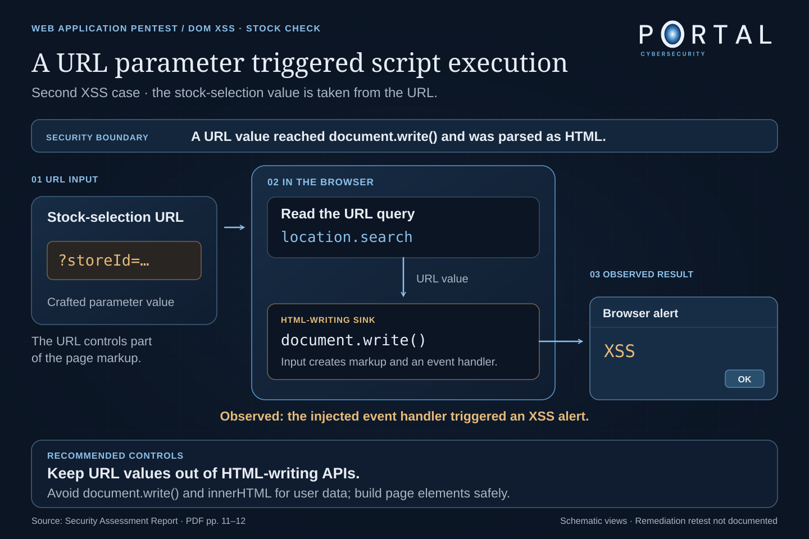
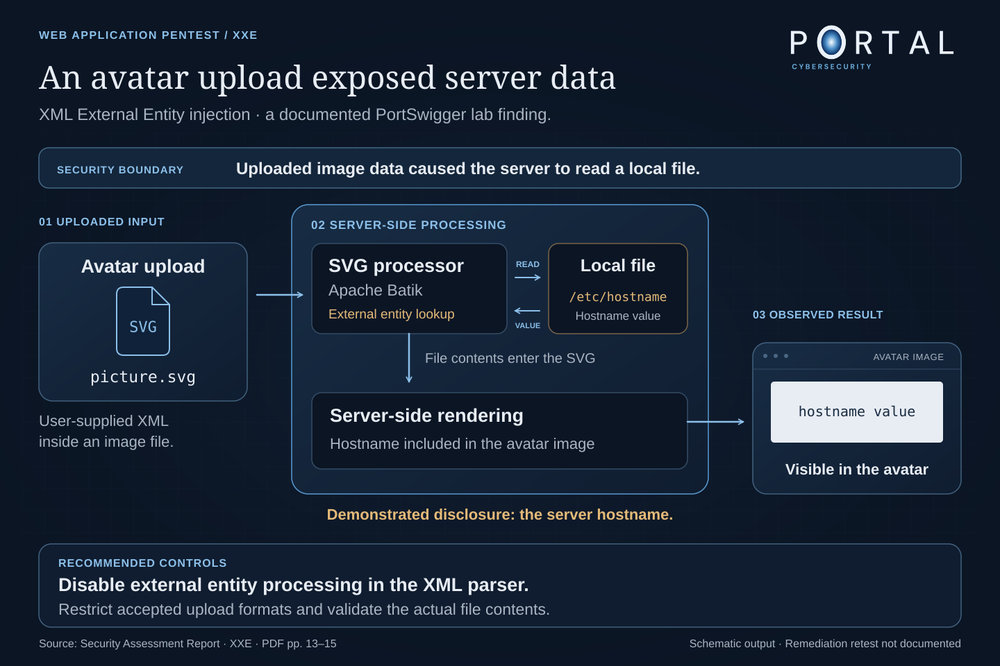

# Project: "Web Application Penetration Testing/Security Assesment Report"

This project was part of the Application Security course, focusing on conducting ethical hacking exercises on web applications within the PortSwigger lab platform. The assignment simulated a real-world penetration test (pentest), enabling students to identify, exploit and document security vulnerabilities in a structured and professional manner.

## Project Objectives: 
- Perform a penetration test of web applications to uncover common vulnerabilities, such as injection flaws, authentication weaknesses, and security misconfigurations.
- Document the findings in a comprehensive pentest report, including technical details and actionable recommendations for remediation.
- Develop hands-on expertise in using Burp Suite and other tools to analyze and exploit vulnerabilities.
- Enhance understanding of secure coding practices and how to prevent vulnerabilities in real-world applications.

## Deliverables:
* Pentest Report:
  - Detailed documentation of vulnerabilities identified during the testing process, including:
    - Injection attacks (e.g., SQL Injection, Command Injection).
    - Cross-Site Scripting (XSS) and Cross-Site Request Forgery (CSRF).
    - Insecure Deserialization and other OWASP Top 10 vulnerabilities.
  - Recommendations for mitigation, referencing industry best practices such as OWASP Top 10 and secure development guidelines.

* Ethical Hacking Exercises:
  - Practical exploitation of web application vulnerabilities using tools like BurpSuite.
  - Simulated attacks to demonstrate real-world risks while maintaining ethical boundaries.

## Illustrated findings

### SQL injection in the product filter

Source: [Report pages 7–9](SecurityAssesmentReport%20-%20APS.pdf#page=7).

### XSS in blog search

Source: [Report pages 10–12](SecurityAssesmentReport%20-%20APS.pdf#page=10).

### DOM XSS in stock check

Source: [Report pages 11–12](SecurityAssesmentReport%20-%20APS.pdf#page=11).

### XXE in an avatar upload

Source: [Report pages 13–15](SecurityAssesmentReport%20-%20APS.pdf#page=13).

## Key Learning Outcomes
* Technical Expertise:
  - Hands-on experience in vulnerability identification, exploitation, and reporting.
  - Use of professional tools like Burp Suite to simulate attacks and assess risks.

* Structured Reporting:
  - Ability to create a professional penetration testing report with technical findings, prioritized risks, and actionable recommendations.

* Secure Development Awareness:
  - Insights into preventing vulnerabilities through secure coding practices, proper authentication mechanisms, and secure API implementations.

* Problem-Solving Skills:
  - Application of systematic methodologies to identify vulnerabilities, analyze root causes, and propose solutions that align with organizational security needs.

## Framework references

These references describe the lab's learning context, not attacks on production systems or deployed defensive controls.

- **MITRE ATT&CK:** [T1190 · Exploit Public-Facing Application](https://attack.mitre.org/techniques/T1190/) provides context for application exploitation as an initial-access scenario. [T1059 · Command and Scripting Interpreter](https://attack.mitre.org/techniques/T1059/) is relevant where a command-injection exercise actually invokes an operating-system command or script interpreter. A finding-level mapping requires the individual lab procedure and observed result.
- **MITRE D3FEND:** [D3-ACH · Application Configuration Hardening](https://d3fend.mitre.org/technique/d3f:ApplicationConfigurationHardening/) is a reference for remediation that changes application settings. It does not cover every secure-coding recommendation, and no implementation is inferred from the project summary.

OWASP remains the primary reference for the vulnerability classes described here. SQL injection, XSS, CSRF and insecure deserialization should not receive ATT&CK identifiers solely from their vulnerability names.

### Related standards and frameworks

These are thematic connections to the documented work, or prospective references where the project is incomplete. They do not imply that the original project was designed against these editions.

| Reference                                                                                                               | Relevant area                                           | Project connection and evidence boundary                                                                                                                                                                 |
| :---------------------------------------------------------------------------------------------------------------------- | :------------------------------------------------------ | :------------------------------------------------------------------------------------------------------------------------------------------------------------------------------------------------------- |
| [OWASP WSTG](https://owasp.org/www-project-web-security-testing-guide/) and [OWASP ASVS 5.0.0](https://asvs.owasp.org/) | Test methodology and application security requirements. | Appropriate additional references for the described PortSwigger exercises. They are not asserted to have been the original assessment criteria; requirement-level mapping needs the individual findings. |
| [CIS Controls v8.1](https://www.cisecurity.org/controls/cis-controls-list)                                              | Control 18: Penetration Testing.                        | The lab illustrates scoped testing, reporting and remediation recommendations. A course exercise is not an organizational testing programme.                                                             |
| [NIST CSF 2.0](https://csrc.nist.gov/pubs/cswp/29/the-nist-cybersecurity-framework-csf-20/final)                        | Identify.                                               | Finding and assessing application weaknesses provides relevant experience. Remediation recommendations do not by themselves demonstrate protective measures in operation.                                |

ISO references are thematic; no clause-by-clause assessment has been performed. CIS references identify top-level Controls, not all underlying safeguards. Framework alignment is not certification or proof of compliance.

*Reference review: 14 November 2026. MITRE mappings and the additional framework connections are project-level interpretations, not independently verified security coverage.*
