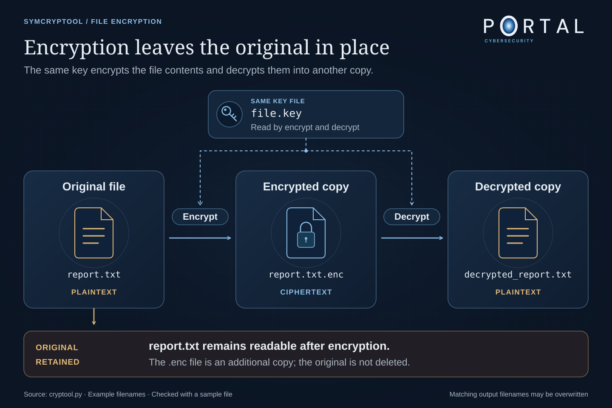

# About This Tool

This tool is designed to securely encrypt and decrypt files using a custom encryption key. 
It’s perfect for protecting sensitive information and ensuring that only authorized users can access it. 
Here’s a quick rundown of what it can do:

- Generate Keys: Create unique encryption keys for securing your files
- Encrypt Files: Secure any file by converting it into an encrypted version with the .enc extension, keeping the original file intact
- Decrypt Files: Restore encrypted files to their original state using the correct key
- User-Friendly Commands: Easily specify files, keys, and actions (encrypt or decrypt)

# Warnings and Considerations

- Key Management:
Always store your encryption keys securely - Losing the key means you won’t be able to decrypt your files.
Avoid sharing your key over insecure channels.

- File Compatibility:
The tool won’t encrypt files that already have the .enc extension and won’t decrypt files without it. Double-check file types before running commands.

- Overwrite Risks:
The tool generates new files for both encryption and decryption. However, if a file with the same name already exists in the directory, it may be overwritten.

- Sensitive Data:
Be cautious when encrypting critical system files or files necessary for running other applications. Missteps could lead to inaccessible or corrupted files.

- Encryption Security:
This tool uses the cryptography library's Fernet module, which provides strong symmetric encryption. However, always follow best practices for key rotation and data management.

## Framework references

| Framework | Reference | Connection to this project |
| :--- | :--- | :--- |
| D3FEND | [D3-FE · File Encryption](https://d3fend.mitre.org/technique/d3f:FileEncryption/) | `encrypt_and_store_info` in [cryptool.py](cryptool.py) encrypts file contents using Fernet and writes an encrypted copy. |
| ATT&CK | [T1005 · Data from Local System](https://attack.mitre.org/techniques/T1005/) | Relevant threat context: an attacker may collect local files. Encryption can limit access to their contents only if plaintext copies and the key are not also accessible. |

The tool retains the original plaintext file and reads its key from a file. This mapping identifies the implemented encryption function, not verified protection against local data collection. Legitimate file encryption is not classified as ATT&CK Data Encrypted for Impact.

### Related standards and frameworks

These are thematic connections to the documented work, or prospective references where the project is incomplete. They do not imply that the original project was designed against these editions.

| Reference | Relevant area | Project connection and evidence boundary |
| :--- | :--- | :--- |
| [ISO/IEC 27002:2022](https://www.iso.org/standard/75652.html) | Cryptography and protection of information. | Fernet file encryption is a concrete technical example. Key protection and retained plaintext limit the protection provided. |
| [CIS Controls v8.1](https://www.cisecurity.org/controls/cis-controls-list) | Control 3: Data Protection. | Encryption addresses one aspect of protecting stored information. Classification, retention, disposal and enterprise-wide key management are not established by this tool. |
| [NIST CSF 2.0](https://csrc.nist.gov/pubs/cswp/29/the-nist-cybersecurity-framework-csf-20/final) | Protect — Data Security (PR.DS). | The encrypted copy supports confidentiality only when plaintext and keys are appropriately protected. This is not a complete implementation of the category. |

ISO references are thematic; no clause-by-clause assessment has been performed. CIS references identify top-level Controls, not all underlying safeguards. Framework alignment is not certification or proof of compliance.

*Reference review: 14 November 2026. MITRE mappings and the additional framework connections are project-level interpretations, not independently verified security coverage.*
